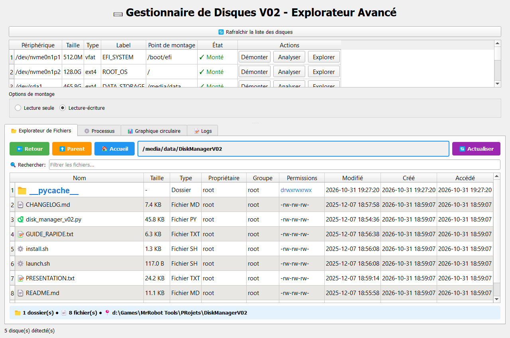
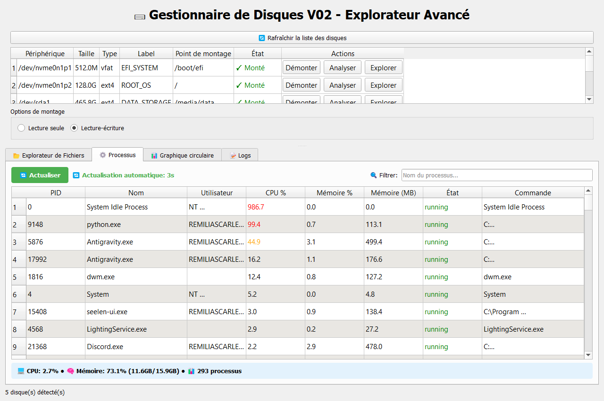
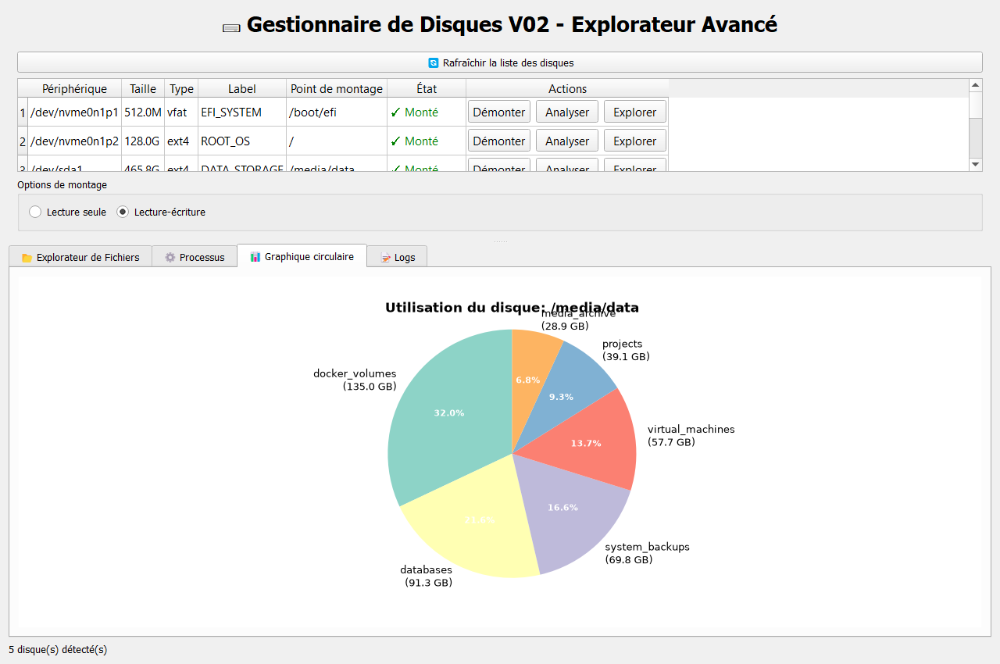
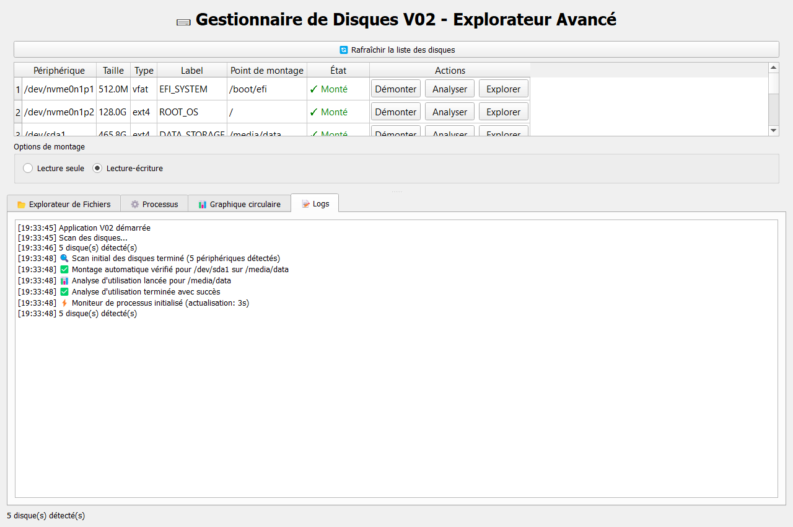

# 🖴 DiskManager-V02

<p align="center">
  
  
  
  
  
</p>

An advanced, feature-rich desktop utility engineered with **Python** and **PyQt5** designed for Linux system administration. **DiskManager-V02** combines block device partition management, a deep filesystem inspector displaying native Unix permissions, a real-time process supervisor, and graphical storage breakdown charts in a unified, intuitive GUI.

---

## 📸 Interface & Live Demonstrations

### 1. Advanced Filesystem Explorer
Explore any mounted filesystem with deep file metadata, real-time search filtering, and live Unix permission translation (`rwxrwxrwx`, owner UID/GID, formatted file sizes, and modification timestamps).

<p align="center">
  
</p>

---

### 2. Real-Time Process Supervisor
Monitor active system processes, tracking CPU and memory resource consumption in real-time with visual load thresholds and termination controls.

<p align="center">
  
</p>

---

### 3. Matplotlib Storage Usage Visualization
Interactive multi-color pie charts providing an instant proportional breakdown of disk space allocated across subdirectories.

<p align="center">
  
</p>

---

### 4. Operations & Diagnostics Log
Real-time console logging for all background partition scans, mounting operations, and system interactions.

<p align="center">
  
</p>

---

## ✨ Core Features

### 🖴 Disk & Block Device Administration
- **Automated Device Discovery**: Uses non-blocking background threads (`QThread`) with `lsblk -J` to discover NVMe, SATA, SSD, and USB drives without freezing the UI.
- **Mount & Unmount Control**: Easily mount or safely dismount drives to designated mountpoints with privilege escalation (`sudo` / `pkexec`).
- **Filesystem Detection**: Native identification of `ext4`, `vfat`, `ntfs`, `btrfs`, `exfat`, and swap partitions.

### 📂 Advanced Filesystem Explorer
- **Detailed 9-Column Inspector**:
  - File / Folder Name with type-specific glyphs (30+ file types identified).
  - Formatted size calculation (Bytes, KB, MB, GB, TB).
  - File extension & MIME categorization.
  - POSIX Owner & Group names via `pwd` and `grp`.
  - Unix permission string (`drwxr-xr-x`, `-rw-r--r--`).
  - Timestamps: Modification, Metadata Change, and Last Access.
- **Interactive Navigation**: History navigation stack (Back, Up, Home), path bar, and instant directory jump.
- **Context Menu Actions**: Direct file opening, copy path, file properties modal, and instant terminal launch.

### ⚙️ System Process Supervisor
- **Live Metrics**: Process ID (PID), process name, owner, CPU % utilization, and RAM allocation (MB and %).
- **Adaptive Visual Warning**: Color-coded highlights (Green for active, Blue for sleeping, Orange/Red for intensive resource utilization).
- **Process Management**: Safe process termination dialogs with PID verification.

### 📊 Storage Analytics
- **Proportional Pie Charts**: Powered by Matplotlib Qt backend (`FigureCanvasQTAgg`), visualizing space consumption across subtrees.
- **Dynamic Breakdown**: Automatically sorts top space-consuming folders and groups miscellaneous items.

---

## 🏗️ Architecture & Component Overview

```text
DiskManagerV02/
├── disk_manager_v02.py       # Core application & PyQt5 GUI architecture
│   ├── DiskScanner (QThread) # Background asynchronous block device discovery
│   ├── DiskAnalyzer (QThread)# Multithreaded directory size & usage computation
│   ├── FileExplorerWidget    # POSIX filesystem explorer with detailed metadata
│   ├── ProcessViewerWidget   # Real-time psutil process monitoring widget
│   ├── PieChartWidget        # Matplotlib interactive storage visualizer
│   └── DiskManagerGUI        # Main window, navigation tabs, and system journal
├── requirements.txt          # Python dependencies
├── install.sh                # Automated dependency installer for Linux
├── launch.sh                 # Fast launcher script
├── CHANGELOG.md              # Version progression and change records
├── GUIDE_RAPIDE.txt          # Quick-start documentation (French)
├── PRESENTATION.txt         # Comprehensive project summary
└── docs/
    └── screenshots/          # High-resolution application screenshots
```

---

## 🚀 Getting Started

### Prerequisites

- **Python**: 3.8 or higher
- **Operating System**: Linux (Ubuntu, Debian, Fedora, Arch Linux, openSUSE)
- **Root Privileges**: Required only for mounting/unmounting devices and terminating root-owned processes.

### 1. Clone the Repository

```bash
git clone https://github.com/LibrarianPoms/DiskManager-V02.git
cd DiskManager-V02
```

### 2. Automated Installation (Linux)

You can run the provided installation script:

```bash
chmod +x install.sh launch.sh
./install.sh
```

### 3. Manual Installation

#### On Debian / Ubuntu / Linux Mint:
```bash
sudo apt update
sudo apt install python3-pip python3-pyqt5 python3-matplotlib
pip3 install -r requirements.txt
```

#### On Arch Linux / Manjaro:
```bash
sudo pacman -S python-pyqt5 python-matplotlib python-psutil
```

#### On Fedora:
```bash
sudo dnf install python3-qt5 python3-matplotlib python3-psutil
```

### 4. Running the Application

```bash
# Launch directly with Python
python3 disk_manager_v02.py

# Or via the launcher
./launch.sh
```

---

## 🔒 Security & Safe Usage

> [!WARNING]
> Mounting or unmounting active partitions (especially system partitions such as `/` or `/boot`) can disrupt running applications. Always verify that target storage devices are not undergoing active I/O write operations before unmounting.

---

## 📄 License

This project is licensed under the **MIT License** - see the [LICENSE](LICENSE) file for details.

---

## 👥 Authors & Acknowledgments

Developed and maintained by **[LibrarianPoms](https://github.com/LibrarianPoms)** and contributors.
Contributions, feature requests, and bug reports are welcome via GitHub Issues and Pull Requests.
